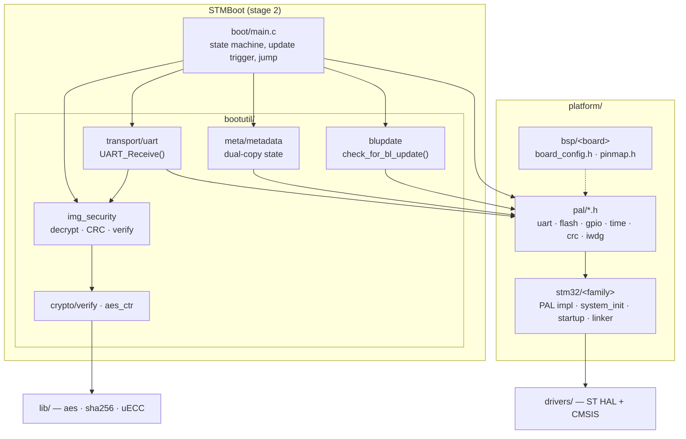
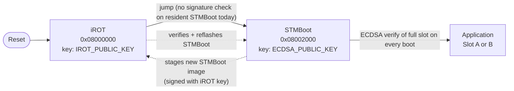
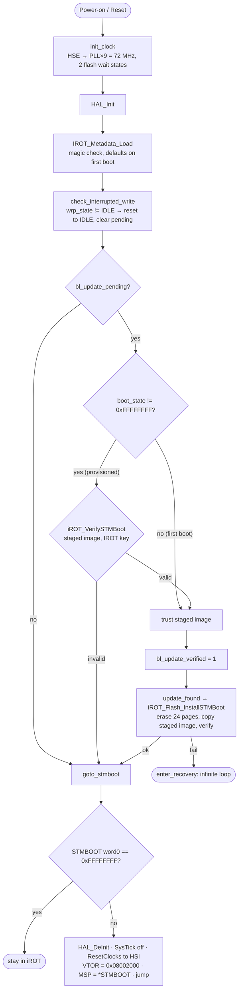
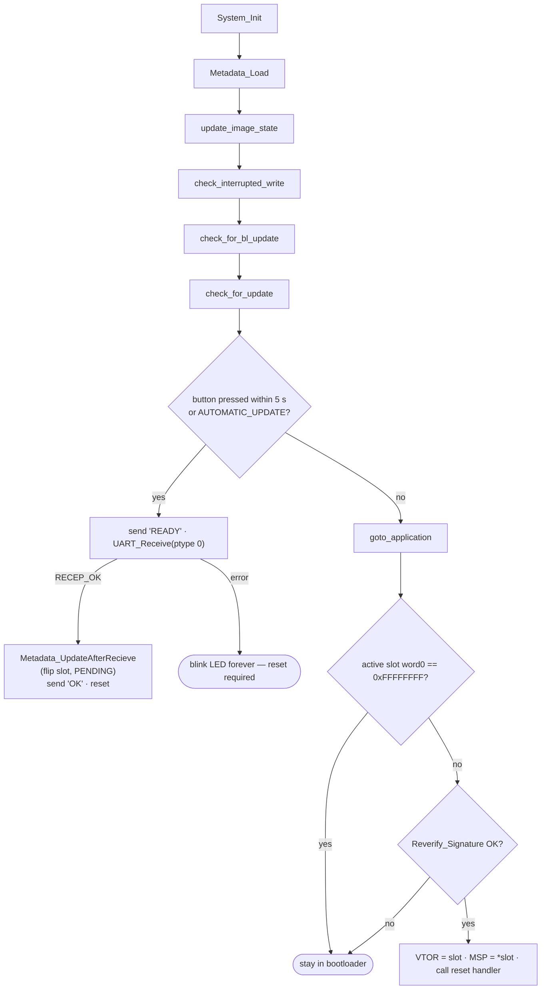
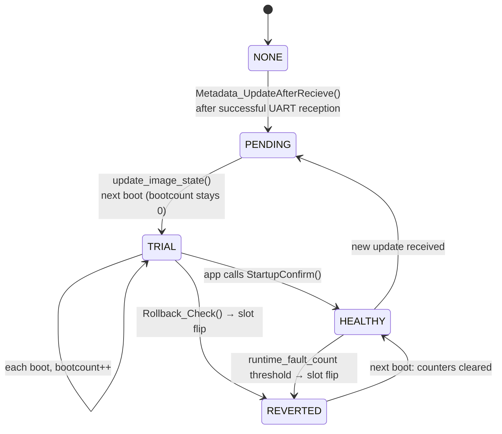

# stm32xboot documentation

> Two-stage secure bootloader for STM32 (verified target: NUCLEO-F103RB) with dual-slot A/B firmware, ECDSA P-256 signature verification, AES-128-CTR transport encryption, power-loss-safe metadata, and bootloader self-update through an immutable Root of Trust (iROT).

---

## Table of Contents

1. [Overview](#1-overview)
2. [Architecture](#2-architecture)
3. [Flash Map](#3-flash-map)
4. [Boot Flow](#4-boot-flow)
5. [State Machines](#5-state-machines)
6. [Metadata](#6-metadata)
7. [Security Model](#7-security-model)
8. [Update Protocols](#8-update-protocols)
9. [Host Tooling (Python)](#9-host-tooling-python)
10. [Build System](#10-build-system)
11. [Testing & Static Analysis](#11-testing--static-analysis)
12. [Third-Party Libraries](#12-third-party-libraries)

---

## 1. Overview
| Property | Value |
|---|---|
| MCU | STM32F103RB (Cortex-M3, 128 KB flash, 20 KB RAM) — NUCLEO-F103RB |
| Application slots | 2 × 47 KB (Slot A / Slot B), A/B swap by flipping a metadata flag |
| Update transport | UART (USART2) |
| Signature | ECDSA P-256 over SHA-256|
| Transport encryption | AES-128-CTR, per-upload 16-byte IV, compiled-in shared key |
| Integrity | STM32 hardware CRC32 (over signed plaintext) + dual metadata copies with CRC |
| Rollback / anti-downgrade | Boot-count trial period, IWDG fault counter, strictly-increasing version check |
| Power-loss handling | During flash op, metadata save, mid-update |
| Bootloader self-update | STMBoot receives new version of itself signed by the iROT key, stages it, iROT verifies, installs, and boots |
| Logging | Compile-time: none / raw UART strings / printf |

### Design goals
- Footprint under 24 KB.
- Portable across STM32 families by adding a `platform/stm32/<family>/` folder and a board CMake file.

---
## 2. Architecture
### 2.1 Seperation of Concerns


### 2.2 Two-stage boot and trust chain



Two independent ECDSA P-256 key pairs exist:

| Key pair | Public half lives in | Private half used by | Signs |
|---|---|---|---|
| Application key | `stmboot/bootutil/crypto/public_key.h` (`ECDSA_PUBLIC_KEY`) | `scripts/private_key.pem` | Application images |
| iROT key | `iROT/keys/iROT_public_key.h` (`IROT_PUBLIC_KEY`) — compiled into **both** iROT and STMBoot | `scripts/iROT_private_key.pem` | STMBoot images |

STMBoot embeds `IROT_PUBLIC_KEY` only so it can pre-verify a received bootloader image (`Verify_BL`) before asking the iROT to install it; the iROT re-verifies independently.

---

## 3. Flash Map

```
STM32F103RB — 128 KB flash (0x08000000 – 0x08020000), 1 KB pages
────────────────────────────────────────────────────────────────────
0x08000000 ┌──────────────────────────────────────────┐
           │ iROT code                    7 KB        │  iROT/linker/STM32F103XX_IROT.ld
0x08001C00 ├──────────────────────────────────────────┤
           │ iROT metadata                1 KB        │  IROT_METADATA_ADDRESS
0x08002000 ├──────────────────────────────────────────┤
           │ STMBoot                      24 KB       │  STMBOOT_ADDRESS (24 pages)
0x08008000 ├──────────────────────────────────────────┤
           │ Slot A                       47 KB       │  SLOTA_START_ADDRESS
0x08013C00 ├──────────────────────────────────────────┤
           │ Slot B                       47 KB       │  SLOTB_START_ADDRESS
0x0801F800 ├──────────────────────────────────────────┤
           │ STMBoot metadata copy 1      1 KB        │  METADATA_ADDRESS_SLOT1
0x0801FC00 ├──────────────────────────────────────────┤
           │ STMBoot metadata copy 2      1 KB        │  METADATA_ADDRESS_SLOT2
0x08020000 └──────────────────────────────────────────┘  FLASH_EOF
```

**RAM:** 20 KB at `0x20000000` for iROT, STMBoot, and the app (each links independently; `_estack = 0x20005000`). Linker scripts reserve `_Min_Heap_Size = 0x200`, `_Min_Stack_Size = 0x400`.

**Maximum image size:** `SLOT_NUM_PAGES × FLASH_PAGE_SIZE_BL` = **48,128 bytes**, *including* the 64-byte signature (enforced in `UART_Receive`, returns `RECEP_ERR_SIZE`).

---

## 4. Boot Flow

### 4.1 Stage 1 — iROT (`iROT/src/main.c`)



Notes:
- SysTick is disabled around the ECDSA verify and flash install (`SYST_CSR = 0`), then restored.
- Write-protection (WRP) handling is stubbed: `wrp_state` and the WRP enable/disable functions exist but are commented out for now. 

### 4.2 Stage 2 — STMBoot (`stmboot/boot/main.c`)



**Active slot selection:** `SLOTA_LATEST != 0` → boot Slot A, else Slot B. The *update target* is always the other slot.

**Signature verified on every boot:** `Reverify_Signature()` hashes the entire stored image (`meta->fw_size − 64` bytes) and runs `uECC_verify` before each jump. This ties boot latency to image size.

**Button logic (NUCLEO-F103RB):** B1 on PC13 reads low when pressed. `check_for_update` polls for up to 5000 ms; pressing breaks out and enters update mode. If `AUTOMATIC_UPDATE` is set, the loop runs once and update mode is entered immediately.

---

## 5. State Machines

Three independent state fields live in `Metadata`.

### 5.1 `image_state` — lifecycle of the installed image

| Value | Name | Meaning |
|---|---|---|
| 0 | `IMG_STATE_NONE` | No firmware installed / fresh flash |
| 1 | `IMG_STATE_PENDING` | New image received and committed, not yet booted |
| 2 | `IMG_STATE_TRIAL` | Booted at least once, not yet confirmed by the app |
| 3 | `IMG_STATE_HEALTHY` | App confirmed itself (`StartupConfirm` / `stmboot_confirm_image`) |
| 4 | `IMG_STATE_REVERTED` | Rolled back to previous slot |



Rollback constants (`metadata.h`): `BOOT_COUNT_MAX = 3`, `RUNTIME_BOOT_COUNT_MAX = 10`.
Rollback action (`Rollback_Check`): flip `SLOTA_LATEST`, `bootcount = 0`, `image_state = REVERTED`, save.

> ⚠ The implemented condition differs from the intended behaviour

### 5.2 `bl_state` — low-level flash operation in flight (Window 1)

| Value | Name | Meaning |
|---|---|---|
| 0 | `BL_STATE_IDLE` | No erase/write in progress |
| 1 | `BL_STATE_ERASING` | Slot erase started, not confirmed complete |
| 2 | `BL_STATE_WRITING` | Chunk writes started, not confirmed complete |

### 5.3 `fwu_state` — position inside the firmware-update protocol (Window 3)

| Value | Name | Set when |
|---|---|---|
| 0 | `FWU_STATE_IDLE` | No update in progress |
| 1 | `FWU_STATE_START` | `UART_Receive()` entered |
| 2 | `FWU_STATE_ERASEDSLOT` | Target slot erased, ACK sent |
| 3 | `FWU_STATE_WRITECOMPLETE` | All chunks written |
| 4 | `FWU_STATE_CRCVERIFIED` | CRC32 matched |
| 5 | `FWU_STATE_ECCVERIFIED` | ECDSA signature valid |

### 5.4 Power-loss recovery (`check_interrupted_write`)

Runs every boot, before the update window. `slot_addr` is the **inactive** slot (the update target). `AUTOMATIC_UPDATE` is a RAM flag that, when set, skips the button and immediately re-enters update mode so a host script can resume.

| Persisted condition | Action | Next |
|---|---|---|
| `bl_state == IDLE` and `fwu_state == IDLE` | Nothing | Normal boot |
| `bl_state` = `ERASING` or `WRITING` | Re-erase target slot; `bl_state = IDLE`, `fwu_state = IDLE`; save | `AUTOMATIC_UPDATE = 1` |
| `fwu_state == START` | Reset to IDLE (RAM only) | `AUTOMATIC_UPDATE = 1` |
| `fwu_state` = `ERASEDSLOT` / `WRITECOMPLETE` | Re-erase target slot; `fwu_state = IDLE`; save | `AUTOMATIC_UPDATE = 1` |
| `fwu_state == CRCVERIFIED` | `Reverify_Signature(slot)`: if valid → `ECCVERIFIED` then `Metadata_UpdateAfterRecieve`; else erase slot, `IDLE` | commit or `AUTOMATIC_UPDATE = 1` |
| `fwu_state == ECCVERIFIED` | `Metadata_UpdateAfterRecieve` (finish commit) | normal boot into new image |
| any other value | Re-erase slot; `IDLE` | `AUTOMATIC_UPDATE = 1` |

**Metadata write interruption (Window 2)** is handled by the dual-copy scheme. Host-side resume (`RESUME_RESTART`) is not yet implemented — the host script simply restarts the whole transfer.

### 5.5 iROT `wrp_state`

`IROT_WRP_IDLE(0) / DISABLING(1) / DISABLED(2) / ENABLING(3) / ENABLED(4)` — designed so iROT can survive the option-byte-induced resets while toggling write-protection around a bootloader reflash. WRP toggling is currently commented out; `check_interrupted_write` simply resets any non-idle state to `IDLE` and clears `bl_update_pending`.

---

## 6. Metadata

### 6.1 STMBoot `Metadata` struct (`bootutil/meta/metadata.h`)

Packed, little-endian, **66 bytes** (guarded by `_Static_assert(sizeof(Metadata) == 66)` and `<= 1024`).

| Offset | Field | Type | Description |
|---:|---|---|---|
| 0 | `magic` | u32 | `0xDEADBEEF` (`METADATA_MAGIC`) |
| 4 | `SLOTA_LATEST` | u32 | Non-zero → Slot A holds the active firmware; zero → Slot B |
| 8 | `bootcount` | u32 | Incremented each boot while `TRIAL`; cleared by confirm / commit |
| 12 | `FW_VER_MAJOR` | u8 | Installed firmware version (written by the app on confirm) |
| 13 | `FW_VER_MINOR` | u8 | |
| 14 | `BL_VER_MAJOR` | u8 | Installed bootloader version, used for BL anti-downgrade |
| 15 | `BL_VER_MINOR` | u8 | |
| 16 | `_pad` | u16 | |
| 18 | `image_state` | u32 | `ImageState` |
| 22 | `runtime_fault_count` | u32 | IWDG-reset counter for a `HEALTHY` image |
| 26 | `sequence` | u32 | Monotonic write counter (newer = larger) |
| 30 | `iv[16]` | u8[16] | AES-CTR IV of the last received image |
| 46 | `fw_size` | u32 | Stored image size **including** 64-byte signature |
| 50 | `bl_state` | u32 | `BLState` |
| 54 | `fwu_state` | u32 | `FWUState` |
| 58 | `bl_update_requested` | u32 | Gate for the bootloader self-update path |
| 62 | `crc` | u32 | CRC32 over bytes `[0, offsetof(crc))` |

### 6.2 Dual-copy metadata (power-loss-safe persistence)

Two 1 KB pages hold two copies: `METADATA_ADDRESS_SLOT1` (`0x0801F800`) and `METADATA_ADDRESS_SLOT2` (`0x0801FC00`).

**Active copy selection (`return_Active_Metadata_Address`):**
1. A copy is *candidate-valid* if `magic == METADATA_MAGIC` and `sequence != 0xFFFFFFFF`.
2. Only one candidate → that one.
3. Both candidates → higher `sequence` wins; equal sequence → copy 1.
4. Neither → copy 1.

**`Metadata_Load`:** takes the active copy and additionally requires CRC to match. Otherwise (first boot or corruption) it writes factory defaults (`SLOTA_LATEST = 1`, state `NONE`, `sequence = 1`, versions `0.0`) via `Metadata_Save`.

**`Metadata_Save`:** writes to the **inactive** copy — erase page, then program `temp` where `temp.sequence = active.sequence + 1` and `temp.crc` recomputed. The active copy is never touched, so an interrupted save leaves the previous state intact.

> The CRC is *not* checked during active-copy arbitration, only in `Metadata_Load`. If the newest copy has a valid magic but a bad CRC (torn write that got past the magic word), `Metadata_Load` falls to defaults rather than to the older copy.

### 6.3 iROT `IROT_Metadata` (`iROT/inc/iROT_metadata.h`)

Single copy at `0x08001C00`, 7 × u32 = 28 bytes, **no CRC** (stubbed).

| Field | Description |
|---|---|
| `magic` | `0xDEADBEEF` |
| `bl_update_pending` | A staged STMBoot image is waiting |
| `bl_update_verified` | Staged image passed signature check this boot |
| `bl_bin_addr` | Flash address of the staged image (inactive app slot) |
| `bl_bin_size` | Size of staged image incl. signature |
| `wrp_state` | `IROT_WRP_State` |
| `boot_state` | `0xFFFFFFFF` = first boot (`IROT_STATE_FIRST_BOOT`, trusts staged image), `0x00000000` = provisioned (`IROT_STATE_PROVISIONED`) |

---

## 7. Security Model

### 7.1 Image format

```
┌──────────────────────────────┬───────────────────────┐
│ firmware (Application.bin)   │ ECDSA signature       │
│ N bytes                      │ 64 bytes = r(32)‖s(32)│
└──────────────────────────────┴───────────────────────┘
        ◄───────── "signed plaintext" (N + 64) ─────────►
```

- Signature = ECDSA-P256 over **SHA-256(firmware)**, big-endian `r‖s`, appended by `scripts/sign_firmware.py`.
- On-device verification reads the last 64 bytes from flash and hashes `[slot_start, slot_start + size − 64)`.

### 7.2 Verification pipeline during reception

For each 1 KB chunk (`security_processChunk`): **AES-CTR decrypt in place → accumulate hardware CRC → program flash.** Plaintext is never held beyond one chunk. After the last chunk: CRC compare → signature verify against flash contents. On signature failure the target slot is erased.

### 7.3 ECDSA P-256 (micro-ecc)

- Curve `uECC_secp256r1()`; only P-256 enabled in the build (`uECC_SUPPORTS_secp256r1=1`, others `0`, `uECC_OPTIMIZATION_LEVEL=0`, compressed points off).
- `Verify_Firmware()` uses `ECDSA_PUBLIC_KEY`; `Verify_BL()` uses `IROT_PUBLIC_KEY`; both return 1 on valid.
- Public keys are raw 64 bytes (`x‖y`, no `0x04` prefix), generated into C headers by the keygen scripts.

### 7.4 AES-128-CTR (tiny-AES-c)

- Key: 16 bytes, compiled into the bootloader (`AES_KEY` in `bootutil/crypto/aes_ctr.c`) and duplicated in the Python tools.
- IV: 16 bytes, sent in the clear during the handshake and stored in `meta->iv`. The Python side uses a full 128-bit big-endian counter (`pycryptodome`, `nonce=b''`, `initial_value=IV`), which matches tiny-AES-c's CTR increment.
- Chunking constraint: chunk size (1024) must be a multiple of 16 for every chunk except the last, because the decrypt context is called per chunk.
- Purpose: confidentiality of the image on the wire. Authenticity comes from the ECDSA signature, not from the cipher.

### 7.5 CRC32

Hardware CRC peripheral: polynomial `0x04C11DB7`, init `0xFFFFFFFF`, no reflection, no final XOR, fed as big-endian 32-bit words. A trailing partial word is padded with `0xFF`. Computed over the **signed plaintext** (post-decryption on the MCU, pre-encryption on the host). The same function (`compute_crc32_stm32`) is implemented bit-serially in the Python scripts. Also used for the metadata CRC.

---

## 8. Update Protocols

Both update types share one state machine, `UART_Receive(header, meta, ptype)` in `bootutil/transport/uart/uart_reception.c`. `ptype = 0` is a firmware update; `ptype = 1` is a bootloader update.

All text replies are ASCII terminated by `\r\n`. All multi-byte integers on the wire are **little-endian**. UART: 115200 8N1, no flow control.

### 8.1 Header

| Byte | Firmware update | Bootloader update | Meaning |
|---:|---|---|---|
| 0 | `0xAA` | `0xCC` | start byte 0 (`FW_RECEP_START_0` / `BL_RECEP_START_0`) |
| 1 | `0xBB` | `0xDD` | start byte 1 |
| 2 | `MAJOR` | `MAJOR` | version being installed |
| 3 | `MINOR` | `MINOR` | |

### 8.2 Sequence — firmware update (`ptype = 0`)

```mermaid
sequenceDiagram
    participant D as MCU (STMBoot)
    participant H as Host (send_test_ab.py)
    Note over D: B1 pressed within 5 s, or AUTOMATIC_UPDATE
    D->>H: "READY\r\n"
    H->>D: 0xAA 0xBB MAJOR MINOR
    Note over D: check start bytes, require version > installed,<br/>erase inactive slot (bl_state ERASING → IDLE, fwu ERASEDSLOT)
    D->>H: "A\r\n" or "B\r\n"  (slot being programmed)
    D->>H: "ACK\r\n"
    H->>D: SIZE (u32 LE) — encrypted length = signed length
    D->>H: "ACK\r\n"
    H->>D: IV (16 bytes)
    Note over D: AES_init_ctx_iv, CRC reset, bl_state = WRITING
    D->>H: "ACK\r\n"
    loop each chunk (≤ 1024 B)
        H->>D: encrypted chunk
        Note over D: AES-CTR decrypt → CRC accumulate → flash write
        D->>H: "ACK\r\n"
    end
    Note over D: bl_state IDLE, fwu WRITECOMPLETE
    D->>H: "ACK\r\n"  (whole data received)
    H->>D: CRC32 (u32 LE) over signed plaintext
    Note over D: compare; fwu CRCVERIFIED
    D->>H: "ACK\r\n"
    Note over D: ECDSA verify slot contents; fwu ECCVERIFIED
    D->>H: "ACK\r\n"
    Note over D: back in main: Metadata_UpdateAfterRecieve (flip slot, PENDING)
    D->>H: "OK\r\n"
    Note over D: delay 100 ms, system reset
```

Host-side expectations in `send_test_ab.py`: after the **signature ACK** it waits for the line `OK`; any other line is a failure.

### 8.3 Sequence — bootloader update (`ptype = 1`)

| Aspect | Bootloader update |
|---|---|
| Trigger | `check_for_bl_update()` when `meta->bl_update_requested != 0` (currently forced to 0 every boot) |
| Ready banner | `"BL_READY\r\n"` instead of `"READY\r\n"` |
| Header | `0xCC 0xDD MAJOR MINOR` |
| Version check | Against `BL_VER_MAJOR/MINOR` in metadata |
| Signature key | `IROT_PUBLIC_KEY` (`Verify_BL`) |
| Target | The inactive **application** slot is used as a staging area |
| Final reply | No `"OK"` line is sent on this path; the host script treats the last `ACK` (signature) as success |
| After reception | Metadata is **not** slot-flipped. `check_for_bl_update` clears `bl_update_requested`, loads iROT metadata and calls `IROT_Metadata_SetPending(&irot_meta, stage_addr, meta->fw_size)`; the system reset is commented out, so a manual reset (or reset in a future revision) lets iROT install it |

### 8.4 Result codes (`RECEP_STATUS`)

| Code | Value | Raised when | NACK sent to host |
|---|---:|---|---|
| `RECEP_OK` | 0 | Update fully received and verified | — |
| `RECEP_ERR_START` | 1 | Header start bytes wrong | yes |
| `RECEP_ERR_SIZE` | 2 | `SIZE == 0` or `> 48,128` | yes |
| `RECEP_ERR_RECV` | 3 | DMA receive timeout/error, or flash erase/write failure | DMA errors: yes; flash erase/write errors: **no** |
| `RECEP_ERR_VERSION` | 4 | Incoming version ≤ installed version | yes |
| `RECEP_ERR_SEC` | 5 | `security_begin`/`processChunk` failed, CRC mismatch, or signature invalid (slot erased) | yes |

On any non-OK result `check_for_update()` logs the error and enters `Task_BL_BlinkLED()` forever; a reset is required. Persisted `fwu_state`/`bl_state` then steer the next boot's recovery.

### 8.5 Timing

| Item | Value |
|---|---|
| Header wait / per-chunk DMA timeout | `UART_CHUNK_TIMEOUT_MS` = 10,000 ms |
| CRC word read | `BYTE_TIMEOUT_MS` = 2,000 ms (blocking `PAL_UART_Receive`) |
| Update-button window | 5,000 ms |
| Throughput | ≈ 11.5 KB/s raw at 115200 baud; ≈ 93 ms per 1 KB chunk (per `board_config.h`) |
| Worst-case image (48,128 B) | ≈ 4.2 s of wire time plus flash programming |

---

## 9. Host Tooling (Python)

Dependencies (`scripts/requirements.txt`): `cryptography`, `pycryptodome`, `pyserial`, `cffi`, `pycparser`.

### 9.1 Scripts

| Script | Invocation | Purpose |
|---|---|---|
| `keygen.py` | `python3 keygen.py` (run from `scripts/`) | Generates an **application** P-256 key pair. Writes `private_key.pem` (PKCS#8, unencrypted) and `../stmboot/bootutil/crypto/public_key.h` (`ECDSA_PUBLIC_KEY[64]`). |
| `keygen_iROT.py` | `python3 keygen_iROT.py` | Same for the **iROT** key. Writes `iROT_private_key.pem` and `../iROT/keys/iROT_public_key.h` (`IROT_PUBLIC_KEY[64]`). |
| `sign_firmware.py` | `python3 sign_firmware.py <priv.pem> <in.bin> <out.signed.bin>` | ECDSA-SHA256 signature, DER → raw 64-byte `r‖s`, appended to the image. |
| `encrypt_firmware.py` | `python3 encrypt_firmware.py <in> <out>` | AES-128-CTR encrypts the file. As a library, `encrypt_firmware(input_path, output_path)` **returns the IV**; the CLI form does not print it, so use the function from another script (as the senders do). |
| `send_test_ab.py` | `python3 send_test_ab.py --port <tty> [--baudrate 115200]` | Full firmware update driver (see below). |
| `send_bl2.py` | `python3 send_bl2.py` (no args; edit constants) | Full bootloader-update driver. |
| `../upload.sh` | `sh upload.sh` | Creates `scripts/venv`, installs requirements, runs `send_test_ab.py --port /dev/tty.usbmodem103 --baudrate 115200` (port is hard-coded; edit for your machine). |

### 9.2 `send_test_ab.py` behaviour

1. Opens the serial port, retrying every second until the device appears.
2. Waits up to 10 s for `READY`.
3. Sends the 4-byte header with `FW_VERSION = (1, 3)` (hard-coded constant).
4. Reads the slot letter (`A`/`B`) and the following `ACK`.
5. Picks `../app/build/slotA/Application.bin` or `../app/build/slotB/Application.bin` accordingly — so **both** slot builds must exist.
6. Signs (`private_key.pem` in the working directory) → encrypts (fresh IV from module import) → computes the CRC32 over the signed plaintext.
7. Sends `SIZE`, `IV`, 1024-byte chunks (waiting for an `ACK` after each), then `CRC`, and waits for the extra `ACK`s and final `OK`.
8. On `SerialException`/`OSError`, `TimeoutError`, or `RuntimeError` (e.g. NACK) it waits 1 s and restarts from the beginning — this is how power-loss resume currently works (full restart).

### 9.3 `send_bl2.py` behaviour

Constants at the top: `STMBOOT_BIN = ../stmboot/build/f103rb/debug/Bootloader.bin`, `BL_VERSION = (1, 1)`, `IROT_PRIVATE_KEY = iROT_private_key.pem`, `PORT`, `BAUDRATE`. Waits (effectively indefinitely) for `BL_READY`, sends `0xCC 0xDD` header, signs with the **iROT** key, encrypts, and streams. The script's comments note that the device sends no `OK` on this path.


**Logging (`boot/logging.h`)** — `BL_LOG_LEVEL`:

| Level | Name | Behaviour | Flash cost (per old README) |
|---:|---|---|---|
| 0 | `BL_LOG_NONE` | Compiled out | 0 |
| 1 | `BL_LOG_UART` | `PAL_UART_Transmit` of a string **literal** (uses `sizeof(msg) - 1`, so arguments must be literals) | ~100 B |
| 2 | `BL_LOG_PRINTF` | `printf` via `lib/printf-stdarg.c`; `uart_putchar()` routes to the PAL | ~4 KB |

The CMake target currently hard-codes `BL_LOG_LEVEL=1`.

### 9.2 STMBoot — `bootutil/meta/metadata.h`

| Function | Signature | Description |
|---|---|---|
| `Metadata_Load` | `PAL_Flash_StatusTypeDef Metadata_Load(Metadata *m)` | Loads the newest valid copy, or writes defaults. |
| `Metadata_Save` | `PAL_Flash_StatusTypeDef Metadata_Save(Metadata *m)` | Writes to the inactive copy with `sequence + 1` and fresh CRC. Returns `FLASH_ERR_ERASE` / `FLASH_ERR_WRITE` on failure. |
| `Metadata_IncrementBootCount` | `PAL_Flash_StatusTypeDef Metadata_IncrementBootCount(Metadata *m)` | Reloads active copy into `*m`, `bootcount++`, saves. |
| `Metadata_UpdateAfterRecieve` | `PAL_Flash_StatusTypeDef Metadata_UpdateAfterRecieve(Metadata *m, bool SLOTA_LATEST)` | Reloads active copy, flips `SLOTA_LATEST`, `bootcount = 0`, `image_state = PENDING`, `fwu_state = IDLE`, saves. (Spelling "Recieve" is in the code.) |

### 9.3 STMBoot — `bootutil/img_security.h`

```c
typedef enum { SEC_OK = 0, SEC_ERR_CRC, SEC_ERR_SIG } SEC_Status;
typedef struct { uint32_t total_size; uint32_t bytes_processed; } SEC_Ctx;
```

| Function | Description |
|---|---|
| `SEC_Status security_begin(SEC_Ctx *ctx, uint32_t fw_size, const uint8_t iv[16])` | Resets counters and the CRC unit; initialises AES-CTR with `AES_KEY` and `iv`. |
| `SEC_Status security_processChunk(SEC_Ctx *ctx, uint8_t *chunk, uint32_t chunk_len, uint16_t uart_size)` | Decrypts **in place**, accumulates CRC (running result kept in `crc_result_sec`). The caller then writes the same buffer to flash. `uart_size` is currently unused. |
| `SEC_Status security_verify_crc(SEC_Ctx *ctx, uint32_t received_crc)` | Compares running CRC with the host's value. |
| `SEC_Status security_verify_sig(SEC_Ctx *ctx, uint32_t slot_start, int ptype)` | Reads the trailing 64-byte signature from flash and verifies with the app key (`ptype 0`) or iROT key (`ptype 1`). |
| `bool Reverify_Signature(Metadata *meta, uint32_t slot_addr)` | Context-free re-verification using `meta->fw_size`; used at boot and in recovery. App key only. |

### 9.4 STMBoot — `bootutil/crypto/`

| Symbol | Description |
|---|---|
| `int Verify_Firmware(uint8_t *data, size_t data_len, uint8_t *signature)` | SHA-256 over `data`, then `uECC_verify(ECDSA_PUBLIC_KEY, …)`. Returns 1 if valid. |
| `int Verify_BL(uint8_t *data, size_t data_len, uint8_t *signature)` | Same with `IROT_PUBLIC_KEY`. |
| `uint8_t AES_KEY[16]` | Shared AES-128 key (`aes_ctr.c`). |
| `ECDSA_PUBLIC_KEY[64]` | In `public_key.h`; generated. |

### 9.5 STMBoot — `bootutil/transport/uart/uart_reception.h`

| Symbol | Description |
|---|---|
| `RECEP_STATUS UART_Receive(uint8_t *received_header, Metadata *meta, int ptype)` | Runs the whole protocol. Persists `fwu_state`/`bl_state`/`fw_size`/`iv` as it progresses. Uses file-scope `write_addr` as the running flash write pointer. Receives into a `static uint8_t chunk[UART_RECEP_CHUNK_SIZE]`. |
| `FW_RECEP_START_0/1`, `BL_RECEP_START_0/1` | `0xAA/0xBB`, `0xCC/0xDD`. |

### 9.6 STMBoot — `bootutil/blupdate/blupdate.h`

| Function | Description |
|---|---|
| `int check_for_bl_update(Metadata *meta)` | If `bl_update_requested`: send `BL_READY`, receive a bootloader image into the inactive app slot, then call `IROT_Metadata_SetPending(...)`. Returns 0 if not requested, 1 on reception failure. |

### 9.7 Platform Abstraction Layer (`platform/pal/`)

The contract each family must implement. Implementation for F1 is in `platform/stm32/f1/pal/`.

| Header | Function | Semantics |
|---|---|---|
| `pal_flash.h` | `PAL_Flash_ErasePage(uint32_t page_address)` | Erase one page; address must be 1 KB-aligned else `FLASH_ERR_INVALID_ADDR`. Disables IRQs during the operation. |
| | `PAL_Flash_EraseSlot(uint32_t slot_start, uint32_t num_pages)` | Loops `ErasePage`. |
| | `PAL_Flash_Write(uint32_t dest, const uint8_t *src, size_t len)` | Half-word programming; odd length padded with `0xFF`; `dest` must be 2-byte aligned and erased. Returns `FLASH_OK / FLASH_ERR_WRITE`. |
| | `PAL_Flash_StatusTypeDef` | `FLASH_OK, FLASH_ERR_INVALID_ADDR, FLASH_ERR_ERASE, FLASH_ERR_WRITE` |
| `pal_uart.h` | `PAL_UART_Transmit(const uint8_t*, uint16_t, uint32_t timeout)` | Blocking TX. |
| | `PAL_UART_Receive(uint8_t*, uint16_t, uint32_t timeout)` | Blocking RX. |
| | `PAL_UARTEx_Receive_DMA(uint8_t*, uint16_t size)` | Blocks until **exactly** `size` bytes arrive (via `ReceiveToIdle_DMA` + callback) or `UART_CHUNK_TIMEOUT_MS`; returns `PAL_OK/PAL_TIMEOUT`. |
| | `PAL_UART_DMAStop()` | Abort DMA reception, reset flags. |
| | `PAL_UART_StatusTypeDef` | `PAL_OK, PAL_ERROR, PAL_BUSY, PAL_TIMEOUT` |
| `pal_gpio.h` | `PAL_GPIO_WritePin(void *port, uint16_t pin, PAL_GPIO_PinState)` / `PAL_GPIO_ReadPin(void *port, uint16_t pin)` | Read returns 1/0. |
| `pal_time.h` | `PAL_Delay(uint32_t ms)` / `PAL_GetTick()` | Millisecond tick. |
| `pal_crc.h` | `PAL_CRC_Reset()` / `PAL_CRC_Accumulate(uint8_t*, size_t)` / `PAL_CRC_GetResult()` | CRC-32/MPEG-2-style (poly `0x04C11DB7`, init `0xFFFFFFFF`, no reflect, no xorout), fed as big-endian words; the last partial word is padded with `0xFF`. `Accumulate` returns the running value. |
| `pal_iwdg.h` | `PAL_MX_IWDG_Init()` / `PAL_FREEZE_IWDG()` | Start IWDG (F1: prescaler 256, reload 4095 → roughly 26 s on the ~40 kHz LSI) / freeze it under debugger. Currently not called. |
| `system_init.h` (per family) | `System_Init()`, `PAL_NVIC_SystemReset()`, `Error_Handler()`; globals `huart2`, `hcrc`, `hdma_usart2_rx/tx`, `hiwdg`, `iwdg_reset` | One-shot hardware bring-up and reset-cause capture. |

**BSP contract (`platform/bsp/<board>/board_config.h`, `pinmap.h`):**

| Macro | F103RB value |
|---|---|
| `BOARD_NAME`, `BOARD_FLASH_SIZE_KB`, `BOARD_RAM_SIZE_KB` | `"NUCLEO-F103RB"`, 128, 20 |
| `FLASH_PAGE_SIZE_BL` | `1024U` |
| `SLOTA_START_ADDRESS` / `SLOTB_START_ADDRESS` | `0x08008000UL` / `0x08013C00UL` |
| `SLOT_NUM_PAGES` | `47U` |
| `METADATA_ADDRESS_SLOT1` / `_SLOT2` | `0x0801F800UL` / `0x0801FC00UL` |
| `FLASH_EOF` | `0x08020000` |
| `UART_RECEP_CHUNK_SIZE` | `1024U` |
| `UART_CHUNK_TIMEOUT_MS` | `10000U` |
| `B1_Pin/B1_GPIO_Port` | `GPIO_PIN_13` / `GPIOC` |
| `LD2_Pin/LD2_GPIO_Port` | `GPIO_PIN_5` / `GPIOA` |
| `USART_TX/RX` | PA2 / PA3 |

### 9.8 iROT

| Symbol | Signature | Description |
|---|---|---|
| `IROT_Metadata_Load` | `void (IROT_Metadata *m)` | Loads from `0x08001C00`, or writes defaults (`boot_state = 0xFFFFFFFF`). |
| `IROT_Metadata_Save` | `void (IROT_Metadata *m)` | Erase page, program struct. No CRC, no dual copy. |
| `IROT_Metadata_SetPending` | `void (IROT_Metadata *m, uint32_t addr, uint32_t size)` | Marks a staged image: `bl_update_pending = 1`, `wrp_state = 0`, stores addr/size, `boot_state = PROVISIONED`. |
| `IROT_Metadata_ClearPending` | `void (IROT_Metadata *m)` | Clears pending flag, addr, size. |
| `iROT_VerifySTMBoot` | `bool (uint32_t addr, uint32_t size)` | SHA-256 over `[addr, addr+size−64)`, verify trailing signature with `IROT_PUBLIC_KEY`. |
| `iROT_Flash_InstallSTMBoot` | `int (IROT_Metadata *m, uint32_t size)` | Erase 24 pages at `STMBOOT_ADDRESS`, copy from `m->bl_bin_addr` in 1 KB pieces, re-verify, clear pending. Returns 0 on success, 1 on failure. |
| `init_clock` / `ResetClocks` | `void (void)` | HSE→PLL×9 (72 MHz) / restore HSI before jumping to STMBoot. |
| `main.c` statics | `check_interrupted_write`, `check_for_update`, `update_found`, `goto_stmboot`, `enter_recovery` |  |

### 9.9 Sample bare-metal application (`app/`)

| Symbol | Description |
|---|---|
| `StartupConfirm(uint8_t major, uint8_t minor)` | Intended to mark the image `HEALTHY`, clear `bootcount`, and record the version. **Out of sync with the current bootloader layout** |
| `Flash_*`, `Metadata_*` (`app/Core/Src`) | App-side copies of flash/metadata helpers using the *old* layout. |

---

## 10. Build System

### 10.1 Requirements

CMake ≥ 3.22, Ninja, `arm-none-eabi-gcc` (toolchain file `cmake/gcc-arm-none-eabi.cmake`), Python 3 for tooling. For analysis/tests: `cppcheck`, `clang-tidy`, Ceedling 1.0.1.

### 10.2 STMBoot (`stmboot/CMakeLists.txt`)

```bash
cd stmboot
cmake --preset f103rb-debug       # or f103rb-release
cmake --build --preset f103rb-debug
```

Outputs in `build/f103rb/<debug|release>/`: `Bootloader.elf`, `.bin`, `.hex`, `Bootloader.map` and a size summary.

| Preset | Board | Type |
|---|---|---|
| `f103rb-debug` / `-release` | NUCLEO-F103RB | Debug (`-Os -g3`) / Release (`-Os -flto`, stripped) |
| `g474re-*`, `h743zi-*` | G474RE / H743ZI | Configure **fails** (`FATAL_ERROR "… not yet implemented"`) |
| `static-analysis` (build: `static-analysis-all`) | host | Runs cppcheck + clang-tidy targets |
| `unit-tests` (build: `unit-tests`) | host | `ceedling test:all` |
| `all-tests` (build: `all-tests`) | host | Static analysis + unit tests |

**Compile definitions:** `STM32F103xB`, `USE_HAL_DRIVER`, `BOARD_F103RB`, `BL_LOG_LEVEL=1`, `uECC_SUPPORTS_secp256r1=1` (other curves `0`), `uECC_OPTIMIZATION_LEVEL=0`, `uECC_SUPPORT_COMPRESSED_POINT=0`, `AES128=1`, `CTR=1`, `CBC=0`, `ECB=0`.
**Flags:** `-Wall -fdata-sections -ffunction-sections`, `-Wl,--gc-sections`, `--specs=nano.specs --specs=nosys.specs`, `-Wl,--print-memory-usage`, map file; Release adds `-flto -s`. `-DDEBUG` (if added) only emits a `#warning` and defines `DBG_FORCE_UPDATE`.

**Source set:** `boot/main.c`, `bootutil/{transport/uart/uart_reception.c, blupdate/blupdate.c, meta/metadata.c, img_security.c, crypto/verify.c, crypto/aes_ctr.c}`, `lib/{printf-stdarg.c, aes/src/aes.c, sha256/src/sha256.c, uECC/uECC.c}`, `iROT/src/iROT_metadata.c`, plus the board's PAL, startup, HAL and interrupt sources.

### 10.3 iROT (`iROT/CMakeLists.txt`)

```bash
cd iROT
cmake --preset f103rb-debug && cmake --build --preset f103rb-debug   # → build/f103rb/debug/iROT.elf
```

Linker script `linker/STM32F103XX_IROT.ld` (`FLASH 0x08000000, 7K`). It links only the HAL modules it needs (flash, GPIO, PWR, RCC, CRC, cortex), plus `sha256.c`, `uECC.c`, and shares `pal_flash.c`/`pal_crc.c`/`pal_gpio.c`. No `.bin/.hex` post-build step is defined; flash the ELF.

### 10.4 Application (`app/`)

| Preset | Linker script | Output |
|---|---|---|
| `slotA-Debug` / `slotA-Release` | `STM32F103XX_SLOTA.ld` | `build/slotA/Application.bin` |
| `slotB-Debug` / `slotB-Release` | `STM32F103XX_SLOTB.ld` | `build/slotB/Application.bin` |

Each slot needs its own link address (position-dependent images). `APP_BASE` is injected by the preset and used for `SCB->VTOR` in `SystemInit`.

## 11. Testing & Static Analysis

| Layer | Tooling | State |
|---|---|---|
| Unit tests | Ceedling 1.0.1 + Unity/CMock (`stmboot/tests/unit/project.yml`, `test/test_*.c`) with mocks of `pal_flash`, `pal_crc`, `pal_uart`, `verify`, `aes`, `metadata` | Scaffolding; `test_metadata.c` is a placeholder and `test_uart_reception.c` is stale. Run via preset `unit-tests`. |
| Static analysis | `cppcheck --enable=all --inconclusive --std=c11` (XML → `tests/static/cppcheck.xml`); `clang-tidy` with `bugprone-*, cert-*, clang-analyzer-*, misc-*, readability-*` (minus magic numbers, `cert-err33-c`, `misc-unused-parameters`), warnings-as-errors for `bugprone-*`/`cert-*` (fixes → `clang-tidy-fixes.yaml`) | Targets defined; analysed files: `boot/main.c`, `crypto/*`, `meta/metadata.c`, `uart_reception.c`, F1 `system_init.c` and PAL. Result files are checked in. |
| Integration / acceptance | Not yet implemented. Backlog acceptance list: unsigned firmware rejected; rollback blocked by counter; runtime detects single-bit corruption; custom firmware possible with dev key; brick recovery via button combo; performance (DWT boot time, verify time, update time per size, flash/RAM footprint, flash wear). | Planned |

---

## 12. Third-Party Libraries

| Library | Location | Purpose | License |
|---|---|---|---|
| [tiny-AES-c](https://github.com/kokke/tiny-AES-c) | `lib/aes` | AES-128-CTR | Unlicense |
| [crypto-algorithms](https://github.com/B-Con/crypto-algorithms) | `lib/sha256` | SHA-256 | Public domain |
| [micro-ecc](https://github.com/kmackay/micro-ecc) | `lib/uECC` | ECDSA P-256 | BSD 2-Clause |
| printf-stdarg.c (G. Menie / C. Ettinger) | `lib/printf-stdarg.c` | Small `printf` for `BL_LOG_PRINTF` | LGPL |
| STM32 HAL (F1/G4/H7) | `drivers/` | Peripheral drivers | BSD-3-Clause |
| CMSIS | `drivers/CMSIS` | Core/device headers | Apache-2.0 |
| [Ceedling](https://github.com/throwtheswitch/ceedling) | (host) | Unit tests | MIT |
| Clock-config reference | `iROT/src/iROT_clock.c` (credited in source) | 72 MHz HSE/PLL setup | — |
| CRC reference | `pal_crc.c`, `uart_reception.c` (credited in source) | CRC32 approach (Steppeschool custom bootloader) | — |

Project license: **MIT** (© 2026 Siddarth Manikant).